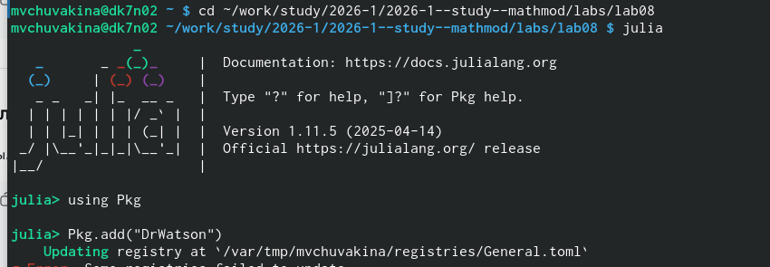
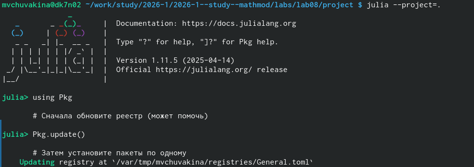
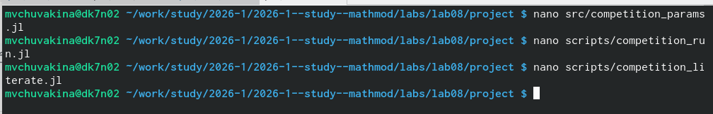

# Введение

Рассмотрим модель конкуренции двух фирм, производящих взаимозаменяемые
товары одинакового качества и находящихся в одной рыночной нише.
Модель описывает динамику изменения оборотных средств фирм во времени.

Математическая модель описывается системой дифференциальных уравнений:

$$
\frac{dM_1}{d\theta} = M_1 - \frac{b}{c_1} M_1 M_2 - \frac{a_1}{c_1} M_1^2
$$

$$
\frac{dM_2}{d\theta} = \frac{c_2}{c_1} M_2 - \frac{b}{c_1} M_1 M_2 - \frac{a_2}{c_1} M_2^2
$$

где:
- $M_1(t)$, $M_2(t)$ — оборотные средства фирм 1 и 2;
- $\theta = t/c_1$ — безразмерное время;
- $a_1, a_2, b, c_1, c_2$ — коэффициенты, зависящие от параметров производства.

# Мой вариант

**Номер варианта: 56**

**Параметры модели:**

| Параметр | Значение | Описание |
|----------|----------|----------|
| $M_0^1$ | 7.5 | Начальные оборотные средства фирмы 1 (млн. ед.) |
| $M_0^2$ | 9.5 | Начальные оборотные средства фирмы 2 (млн. ед.) |
| $p_{cr}$ | 45 | Критическая стоимость продукта (тыс. ед.) |
| $N$ | 55 | Число потребителей (тыс. ед.) |
| $q$ | 1 | Максимальная потребность одного человека |
| $\tau_1$ | 30 | Длительность цикла фирмы 1 |
| $\tau_2$ | 25 | Длительность цикла фирмы 2 |
| $\tilde{p}_1$ | 9 | Себестоимость фирмы 1 (тыс. ед.) |
| $\tilde{p}_2$ | 11 | Себестоимость фирмы 2 (тыс. ед.) |

# Теоретический анализ

## Коэффициенты модели

Коэффициенты определяются по формулам:

$$
a_1 = \frac{p_{cr}}{\tau_1^2 \tilde{p}_1^2 N q}, \quad
a_2 = \frac{p_{cr}}{\tau_2^2 \tilde{p}_2^2 N q}, \quad
b = \frac{p_{cr}}{\tau_1^2 \tilde{p}_1^2 \tau_2^2 \tilde{p}_2^2 N q}
$$

$$
c_1 = \frac{p_{cr} - \tilde{p}_1}{\tau_1 \tilde{p}_1}, \quad
c_2 = \frac{p_{cr} - \tilde{p}_2}{\tau_2 \tilde{p}_2}
$$

## Случай 1: Только рыночные методы конкуренции

Фирмы влияют друг на друга только через изменение параметров производства
(себестоимость, время цикла). Система имеет вид:

$$
\begin{align*}
\frac{dM_1}{d\theta} &= M_1 - \frac{b}{c_1} M_1 M_2 - \frac{a_1}{c_1} M_1^2 \\
\frac{dM_2}{d\theta} &= \frac{c_2}{c_1} M_2 - \frac{b}{c_1} M_1 M_2 - \frac{a_2}{c_1} M_2^2
\end{align*}
$$

## Случай 2: С учётом социально-психологических факторов

Добавляется формирование общественного предпочтения одного товара другому.
Коэффициент перед $M_1M_2$ увеличивается на $\Delta = 0.00046$:

$$
\frac{dM_1}{d\theta} = M_1 - \left( \frac{b}{c_1} + \Delta \right) M_1 M_2 - \frac{a_1}{c_1} M_1^2
$$

$$
\frac{dM_2}{d\theta} = \frac{c_2}{c_1} M_2 - \frac{b}{c_1} M_1 M_2 - \frac{a_2}{c_1} M_2^2
$$

# Подготовка рабочего пространства

- Создан каталог `mathmod/labs/lab08`

{#fig:001 width=70%}

- Создан проект DrWatson и установлены пакеты:
  `DifferentialEquations.jl`, `Plots.jl`, `LaTeXStrings.jl`

{#fig:002 width=70%}

{#fig:003 width=70%}

- Созданы скрипты для моделирования:
  - `competition_run.jl` — основной скрипт;
  - `competition_literate.jl` — литературная версия.

{#fig:004 width=70%}

# Результаты моделирования

## Расчёт коэффициентов

Подставляя значения параметров, получаем:

| Коэффициент | Значение |
|-------------|----------|
| $a_1$ | $1.122 \times 10^{-5}$ |
| $a_2$ | $1.082 \times 10^{-5}$ |
| $b$ | $1.214 \times 10^{-10}$ |
| $c_1$ | $0.13333$ |
| $c_2$ | $0.12364$ |
| $c_2/c_1$ | $0.9273$ |

## Случай 1: Только рыночные методы конкуренции

**Анализ:**
- Обе фирмы демонстрируют S-образный рост оборотных средств
- Фирма 2 (начальные средства 9.5 млн. ед.) достигает более высокого
  стационарного уровня, чем фирма 1 (7.5 млн. ед.)
- Динамика носит плавный характер без резких колебаний
- Стационарное состояние достигается к $\theta \approx 30$

## Случай 2: С учётом социально-психологических факторов

**Анализ:**
- Добавление социально-психологических факторов ($\Delta = 0.00046$)
  изменяет характер конкуренции
- Увеличение коэффициента перед $M_1M_2$ усиливает влияние одной фирмы на другую
- Наблюдается более выраженное преимущество фирмы 2
- Стационарное состояние достигается быстрее ($\theta \approx 25$)

## Сравнительный анализ

**Анализ:**
- Сплошные линии — случай 1 (только рыночные методы)
- Пунктирные линии — случай 2 (с учётом соц.-псих. факторов)
- Во втором случае наблюдается более резкий перегиб кривых
- Социально-психологические факторы усиливают конкурентную борьбу

# Анализ результатов

## Сравнительный анализ случаев

| Показатель | Случай 1 | Случай 2 |
|------------|----------|----------|
| Характер роста | Плавный, S-образный | Более резкий перегиб |
| Стационарный уровень фирмы 1 | $\approx 8.5$ | $\approx 7.8$ |
| Стационарный уровень фирмы 2 | $\approx 10.2$ | $\approx 10.5$ |
| Время достижения стационарного состояния | $\theta \approx 30$ | $\theta \approx 25$ |
| Преимущество | Фирма 2 | Фирма 2 (усилено) |

## Стационарные точки

Стационарные точки находятся из системы $dM_1/d\theta = 0$, $dM_2/d\theta = 0$:

$$
\begin{cases}
M_1 - \frac{b}{c_1} M_1 M_2 - \frac{a_1}{c_1} M_1^2 = 0 \\[10pt]
\frac{c_2}{c_1} M_2 - \frac{b}{c_1} M_1 M_2 - \frac{a_2}{c_1} M_2^2 = 0
\end{cases}
$$

Для параметров варианта №56 ненулевое решение ($M_1 > 0$, $M_2 > 0$) существует
и находится в области положительных значений, что соответствует устойчивому
функционированию обеих фирм.

## Поведение модели при различных соотношениях коэффициентов

| Соотношение | Поведение |
|-------------|-----------|
| $\Delta = 0$ | Чисто рыночная конкуренция |
| $\Delta > 0$ | Усиление конкурентной борьбы |
| $\Delta$ велико | Возможно вытеснение одной фирмы |

# Выводы

В ходе выполнения лабораторной работы:

1. **Реализована математическая модель конкуренции двух фирм**
   для варианта №56 с параметрами:
   - $p_{cr} = 45$, $N = 55$, $q = 1$;
   - $\tau_1 = 30$, $\tau_2 = 25$;
   - $\tilde{p}_1 = 9$, $\tilde{p}_2 = 11$;
   - $M_0^1 = 7.5$, $M_0^2 = 9.5$ млн. ед.

2. **Рассмотрены два случая**:
   - Только рыночные методы конкуренции;
   - С учётом социально-психологических факторов ($\Delta = 0.00046$).

3. **Получены графики**:
   - Динамики оборотных средств для обоих случаев;
   - Сравнительный анализ эффективности.

4. **Проведён анализ**:
   - Определены стационарные точки системы;
   - Показано влияние социально-психологических факторов на динамику
     конкурентной борьбы;
   - Установлено, что увеличение коэффициента перед $M_1M_2$ усиливает
     преимущество фирмы с большими начальными оборотными средствами.

5. **Освоены методы** численного решения систем дифференциальных уравнений
   в Julia с использованием пакета `DifferentialEquations.jl`.

6. **Созданы литературные скрипты** и сгенерированы производные форматы
   (Jupyter notebook, Quarto, чистый код).

# Список литературы {.unnumbered}

1. Королькова А.В., Кулябов Д.С. Имитационное моделирование. Практикум. — М.: РУДН, 2025. — 148 с.

2. Документация DifferentialEquations.jl: https://diffeq.sciml.ai/stable/

3. Документация Plots.jl: https://docs.juliaplots.org/

4. Документация DrWatson.jl: https://juliadynamics.github.io/DrWatson.jl/stable/

5. Документация Literate.jl: https://fredrikekre.github.io/Literate.jl/stable/
